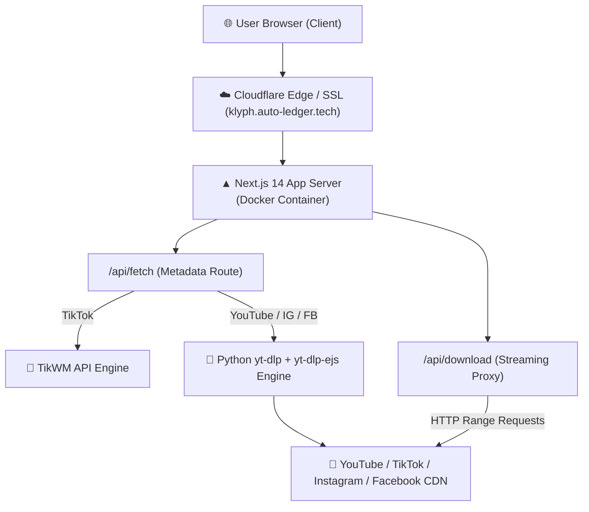

[Klyph.webm](https://github.com/user-attachments/assets/80598bc7-783e-4d4d-a28a-e6fb82270a71)
<div align="center">

# ⚡ KLYPH

### Next-Gen Universal Video & Audio Downloader

**An ultra-fast, modern, ad-free web platform engineered to extract and download high-definition media from YouTube, TikTok, Instagram, and Facebook.**

[](https://nextjs.org/)
[](https://www.typescriptlang.org/)
[](https://www.docker.com/)
[](https://github.com/yt-dlp/yt-dlp)
[](LICENSE)

<br />

🔗 **Live Platform:** [https://klyph.auto-ledger.tech](https://klyph.auto-ledger.tech)  
🌐 **Primary Mirror:** [https://klyph.onrender.com](https://klyph.onrender.com)

</div>

---

## 🎬 Live Product Preview

<div align="center">
  <video src="Klyph.webm" width="100%" controls="controls" muted="muted" style="max-height: 520px; border-radius: 12px; box-shadow: 0 8px 30px rgba(0, 242, 254, 0.15);">
    Your browser does not support the video tag.
  </video>
  <p><em>🎥 Full demo walkthrough of Klyph in action. <a href="Klyph.webm">Click here to download or view the video directly</a>.</em></p>
</div>

---

## 💡 Why Klyph?

Traditional online video downloaders are bloated with intrusive pop-up advertisements, malicious redirects, captchas, and forced low-resolution limits. 

**Klyph** was engineered from the ground up to solve this:
- **Zero Ads & Zero Pop-ups:** Clean, distraction-free interface.
- **Full Quality Preservation:** Downloads raw streams directly without re-compression degradation.
- **Accurate Real-Time Sizing:** Calculates and displays exact file sizes in **KB, MB, or GB** for every available resolution before you click download.
- **High-Speed Resumable Downloads:** Built-in streaming reverse proxy with HTTP `Range` header support.

---

## 🔥 Key Features

| Platform | Supported Resolutions & Media Types | Key Capabilities |
| :--- | :--- | :--- |
| **YouTube** | **4K Ultra HD (2160p)**, **2K Quad HD (1440p)**, **1080p Full HD**, **720p HD**, **480p**, **360p**, **Dedicated MP3 Audio** | Multi-client rotation (`web_embedded` + `tv samsung`), shorts support, and automatic JS challenge solver. |
| **TikTok** | **1080p HD (No Watermark)**, **720p HD (Original)**, **Audio Only (MP3)** | Powered by dedicated TikWM integration with zero watermark retention. |
| **Instagram** | **1080p / 720p Reels**, **Video Posts**, **Carousels** | High-speed direct media link resolution. |
| **Facebook** | **HD 1080p**, **SD Videos** | Handles public posts, reels, and video clips seamlessly. |

### Additional Capabilities
- 📊 **Dynamic File Size Formatting:** Small audio files show in `KB`, standard videos in `MB`, and large 4K streams scale smoothly to `GB` (e.g. `1.25 GB`).
- ⚡ **HTTP Range-Header Streaming Proxy:** The `/api/download` route pipes chunks directly from the edge, enabling browser pause, resume, and multi-threaded acceleration.
- 🛡️ **Automated Cookie Sanitizer:** Built-in parser supporting standard Netscape format, Base64 strings, and auto-repair for broken whitespace/tabs.
- 📱 **Cyberpunk Glassmorphism UI:** Mobile-first responsive design featuring deep dark palettes (`#07090e`), glowing neon cyan accents, and micro-interactions.

---

## 🛠️ Architecture & Tech Stack



### Technology Breakdown
- **Frontend:** [Next.js 14](https://nextjs.org/) (App Router), React 18, TypeScript, [Lucide React](https://lucide.dev/)
- **Backend & APIs:** Next.js Route Handlers (`/api/fetch`, `/api/download`)
- **Extraction Engine:** [yt-dlp](https://github.com/yt-dlp/yt-dlp), `yt-dlp-ejs`, [TikWM API](https://www.tikwm.com/)
- **Runtimes:** Python 3.11, [Deno](https://deno.land/) & Node.js (for signature & n-challenge solving)
- **Containerization:** Multi-stage Dockerfile based on `node:20-slim`
- **Hosting & Infrastructure:** [Render](https://render.com/) Web Service, Cloudflare Edge DNS & Automated SSL

---

## 🚀 Getting Started (Local Development)

### Prerequisites
- **Node.js:** v18.17 or higher
- **Python:** v3.10 or higher
- **FFmpeg:** Installed and added to system PATH

### 1. Clone the Repository
```bash
git clone https://github.com/vthish/Klyph.git
cd Klyph
```

### 2. Install Node Dependencies
```bash
npm install
```

### 3. Install Python Engine Dependencies
```bash
pip install yt-dlp yt-dlp-ejs
```

### 4. (Optional) Configure YouTube Cookies
To bypass YouTube datacenter bot checks in production, you can provide cookies in the project root:
- Place your exported Netscape cookies in a file named `cookies.txt` in the root directory.

### 5. Run Development Server
```bash
npm run dev
```

Open [http://localhost:3000](http://localhost:3000) in your browser to view the application.

---

## 🐳 Docker Deployment

Klyph includes a production-ready, security-hardened `Dockerfile` configured for container platforms such as **Render**, **Railway**, or self-hosted **Docker/Kubernetes**.

### Build Docker Image
```bash
docker build -t klyph-downloader .
```

### Run Container
```bash
docker run -p 3000:3000 --name klyph klyph-downloader
```

The app will be accessible at [http://localhost:3000](http://localhost:3000).

---

## ⚙️ Environment Variables

| Variable | Description | Required |
| :--- | :--- | :--- |
| `PORT` | The port the Next.js server binds to (default: `3000`). | No |
| `YOUTUBE_COOKIES` | Raw Netscape cookie content or Base64-encoded cookie file for YouTube extraction. | Optional (Recommended for Datacenter / Cloud IPs) |
| `/etc/secrets/cookies.txt` | Render Secret Files path (automatically detected and prioritized). | Optional |

---

## 🌿 Branching & Trunk-Based Release Strategy

Klyph follows a strict, disciplined trunk-based release workflow:
1. `feature/*` or `fix/*`: All development work is performed in isolated feature branches.
2. `dev`: Staging branch where all features and fixes are integrated via pull requests.
3. `main`: Production release branch. Merging into `main` automatically rolls out deployments.

---

## 📄 License & Disclaimer

Distributed under the **MIT License**. See `LICENSE` for more information.

> [!NOTE]
> **Disclaimer:** Klyph is developed strictly for educational, research, and personal backup purposes under fair-use provisions. Please respect content creators' intellectual property rights and the terms of service of each respective platform.

---

<div align="center">
  <sub>Built with ❤️ by <a href="https://github.com/vthish">Vithish</a></sub>
</div>
